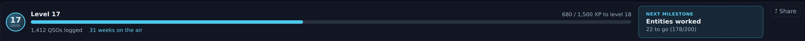
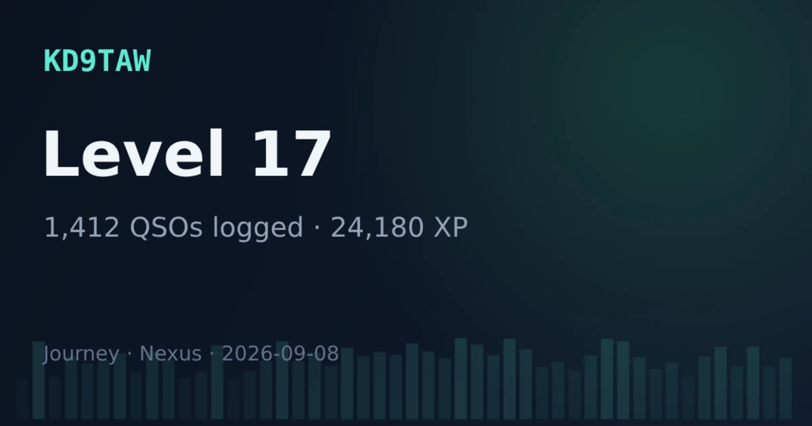

# Awards & Journey

This section has two tabs under one roof: **Official Awards**, the offline
tracker for the official programs (DXCC, Challenge, Honor Roll, WAS, WAZ, VUCC,
IOTA), and **Journey**, a local-only achievement layer that turns your log into
progress you can feel — firsts, ladders, collections, and personal bests. Both
read straight from your [logbook](logbook-qsl.md); neither needs an account or a
network.

Awards is an opt-in section, nudged on after your first QSO. Turn it on any time
in [Settings ▸ Appearance ▸ Features](settings-reference.md#features).

*The Official Awards tab in Nexus 1.10.3. The figures are one station's log;
yours will read differently.*

## Awards — the official programs

Awards are **computed offline** — each contact by the DXCC number and CQ zone
its record carries, else by cty.dat's reading of its callsign — no upload
required to *see* where you stand:

- **DXCC** with per-band and per-mode slots, and **5-Band DXCC**,
- **DXCC Challenge**,
- **Honor Roll**, with a current-entity denominator and a countdown —
  confirmations still needed to get in, then "N to #1" once you're in,
- **WAS** (Worked All States), with the 5BWAS count beside it,
- **WAZ** (Worked All Zones),
- **VUCC**, with satellite grids kept on their own **Sat VUCC** card. ARRL
  credits a bird QSO toward Satellite VUCC only, so the two cards never share
  a grid. Nexus tags pass contacts itself — log one while the transponder is
  held and your dial is in the bird's downlink and it gets `PROP_MODE=SAT`
  plus the LoTW designator, which is what moves this card. The ISS is the one
  exception ([Satellites](satellites.md) explains why), and an imported
  contact moves it only if the file already carried both fields,
- **FFMA** (the ARRL Fred Fish Memorial Award): the 488 grid squares of the 48
  contiguous states, confirmed on 6 m. The card counts them, and the chase lists
  name the squares still needed — worked but not confirmed first, then the ones
  never worked, folded away. Satellite contacts are left out; contacts through a
  repeater do not count for the award either, and Nexus cannot tell those apart,
  so leave them out of an application. A needed 6 m square on the Needed board
  says FFMA in its row,
- **IOTA** (Islands On The Air),
- **USA-CA** (CQ's United States of America Counties Award): the 3,077 counties,
  from the county logged on each contact (`CNTY`), with the award's levels of 500,
  1,000, 1,500, 2,000, 2,500, 3,000 and all 3,077. The county is read as ADIF
  writes it (`IN,Marion`) and as other logs write it (`Marion, IN`,
  `IN, Marion County`, a county alone beside the contact's state). Alaska counts by
  its four Judicial Districts. A Virginia independent city, or Carson City, counts
  for a bordering county of your choosing, so Nexus leaves it uncounted, as it
  does any county it cannot place; the card says how many. A county is confirmed by
  a QSL card or an eQSL from an Authenticity-Guaranteed member, as CQ's rules say;
  CQ names no LoTW credit for this award. The list is the US Census Bureau's,
- **WAP** (Worked All Provinces): the 13 Canadian provinces and territories, from
  the province logged on a Canadian contact, with the ones still to confirm listed,
- **WPX** (CQ): distinct prefixes worked and confirmed, by the prefix rule CQ
  publishes for its WPX programme (<https://www.cqwpx.com/rules/>): a portable
  designator becomes the prefix (PA/N8BJQ counts PA0), a call with no numeral
  takes a zero after its first two letters, and /P, /M, /MM and the licence-class
  suffixes do not count. CQ's award page could not be read when this was built,
  so the card shows no award level, and an Authenticity-Guaranteed eQSL is not
  counted for WPX until that is checked. A designator that is a bare digit
  (N8BJQ/4) counts as N4, which the rules page does not show an example of,
- **WAE** (DARC's Worked All Europe): the 73 countries of DARC's list
  (<https://www.darc.de/der-club/referate/dx/diplome/wae-diplom/wae-laenderliste/>),
  Sicily, Shetland, Bear Island and the other WAE-only areas included, and the
  award's band points — one per confirmed country per band, at most five bands a
  country (<https://www.darc.de/der-club/referate/dx/diplome/wae-diplom/>). The
  card names the highest class reached (WAE III 40 countries and 100 points, II
  50 and 150, I 60 and 200, TOP 70 and 300). Confirmed here means LoTW or a card;
  DARC's own page says nothing about LoTW, so check before applying with a
  LoTW-only country,
- **WWFF** (World Wide Flora & Fauna): the references you have worked, read from
  the WWFF reference logged on each contact (`WWFF_REF`, or `SIG` WWFF). WWFF
  credits only its own log search, never a QSL, so the card counts references
  worked and the WWFF-H levels
  (<https://wwff.co/awards/global-awards/>): 10, then steps of 44 to 444, of 100
  to 4,444, of 200 to 8,444, and of 400 above. No reference directory ships with
  Nexus, so a reference is counted as you logged it.

A WPX prefix or a WAE country never worked does not raise a row on the Needed
board on its own; the Needed board stays DXCC, zone, grid, state and park.

### Award status: Submitted, Granted and Ready to submit

Each contact carries an award status for **DXCC, WAS, WAZ, IOTA and USA-CA**:
not submitted, **Submitted** or **Granted**, in the ADIF fields made for it
(`CREDIT_SUBMITTED`, `CREDIT_GRANTED`) under the award's credit code (`DXCC`,
`WAS`, `CQWAZ_MIXED`, `IOTA`, `USACA`). Set it on the contact card under **Award
status**, or for many contacts at once in **Bulk edit**. Setting one clears the
other; nothing else on the contact changes and nothing is sent; Undo takes it
back. The granted DXCC credit LoTW sends is kept as before.

The **Award status** panel in Awards shows, for the award you pick, the
entities worked, confirmed, submitted and granted, and the contacts **ready to
submit**: one per entity confirmed by that award's own rule (DXCC and WAS: LoTW
or a card; WAZ: those or an Authenticity-Guaranteed eQSL; IOTA: a card or LoTW;
USA-CA: a card or an Authenticity-Guaranteed eQSL) and neither submitted nor
granted, either its oldest confirmed contact or its newest. **Export CSV** and
**Save a page to print** write the list to your Downloads folder. **Mark …
submitted** marks the whole list Submitted: Nexus says how many contacts it will
change and changes them only when you confirm.

### Custom awards

**Custom awards** lets you define your own: a name, and a list of calls,
prefixes, grid squares, references (park, summit, island or WWFF), or values of
any ADIF field (`CNTY`, say), with bands and modes to limit it to. Each item is
one slot, counted worked and confirmed from the log like the awards above;
confirmed means LoTW or a card unless you pick any channel. **Export** saves the
definitions to a file, and **Import** adds a file's awards to your own.

### The DXCC chart

**DXCC chart** shows every current DXCC entity against every band that earns
DXCC band credit, each cell shaded confirmed, worked or needed. Pick a mode (CW,
Phone, Digital or all), filter the entities by name, or show only the entities
with a band still to confirm. The row name is shaded by the entity's own
standing, which also counts the bands with no DXCC band slot (70 cm and up).

### What to QSL

**What to QSL** lists the contacts you have not got confirmed whose
confirmation would fill a slot an award still needs: a new DXCC entity first,
then a DXCC Challenge band, a WAZ zone, a WAS state, a WAP province, a WAE
country, a VUCC grid and a WPX prefix. A contact that fills more slots comes
before one that fills fewer, and each slot names its three newest contacts.
The route logged on the contact (`QSL_VIA`) is shown where there is one. The list
only reads the log; it changes nothing.

Under the cards, DXCC is broken out **by band**, and the chase lists start with
**Confirm for a new one** — entities you have worked but not confirmed, chipped
with the bands each is waiting on.

**Needed by band** lists, for DXCC, WAS or WAZ, each band's count of what you have
never worked there and what you have worked there but not confirmed. Click a count
for the list behind it. DXCC counts the current entities, on the bands that earn
DXCC credit (60 m and 4 m earn none); WAS the 50 states; WAZ the 40 zones.

**The Stats pane beside the log entry** shows the same standing for one station: type
a call in the log entry and the pane shows NEW ONE, NEW BAND and NEW MODE for the band
you are on and the mode you log, which confirmations you hold through LoTW, a card,
eQSL and QRZ for its country and for this call, and a grid for its DXCC entity, its
state (WAS) and its CQ zone (WAZ): CW, phone and digital by 160 m to 23 cm, each slot
not worked, worked or confirmed (DXCC has no slot on 60 m, 4 m, 70 cm, 33 cm or 23 cm). It counts exactly what this page counts. It stands
under the log entry and keeps one height whatever it shows, so nothing beside it moves
as you type, log and clear a call. Phone, CW and JS8 show it by themselves on a window
with room for it beside the whole log form (a maximized window on a 2560×1440 screen,
or any window about 1440 px tall); on a smaller one, 1920×1080 included, and in FT,
RTTY and PSK, tick **Stats** in ⊞ Panels. FT's pane follows the station the callsign
card shows.

**Confirmation handling is source-aware** — a distinction most loggers blur.
**eQSL and a QRZ-logbook match never count toward the ARRL's awards** (DXCC, WAS,
VUCC); CQ's **WAZ** also takes an eQSL from an Authenticity-Guaranteed member, and
the eQSL download keeps that mark on the contact it confirms. The
`confirmed` and `award_confirmed` flags are separate and enforced at every
computation. So a contact can be "confirmed" (you have an eQSL) yet not
"award-confirmed" (no LoTW or card), and the awards math respects the
difference. The
[logbook diagnostics](logbook-qsl.md#understand-why-a-contact-isnt-confirmed)
explain per-QSO why a credit hasn't landed.

That is why the **Confirmed** card here reads lower than the **confirmed**
figure on [Stats](stats.md#the-tour) — 52% against 73% in the screenshot
above. Neither is wrong. This card counts only LoTW and paper cards, because
that is what ARRL takes; Stats counts every channel, eQSL and QRZ included,
because it is describing your log rather than judging it.

## Journey — progress you can feel

Journey exists to carry a newer operator through the motivational dead zone
between QSO 1 and QSO 100 — but it credits an imported logbook immediately, so a
veteran importing years of ADIF sees their history light up at once. It's
**local-only**: no accounts, no network, no decaying daily streaks.

*The Journey hero card, DX Marathon and Firsts row in Nexus 1.10.3.*

What's on the board:

- **XP and levels**, with a hero card.
- **Firsts** — auto-detected milestones ("first DX," "first CW," "first park"),
  each named with heritage context.
- **Ladders** — tiered progress toward the official awards, plus:
  - **DX Marathon** — entities and zones worked this calendar year vs. your best
    year (resets Jan 1),
  - **Grid Gems** — rare/ultra-rare grids worked (rungs at 1/5/10/25/50),
  - **Park Hunter** and **Summit Chaser** — distinct POTA/SOTA references hunted
    (they appear after your first hunt),
- **Seasonal feats** — earned in a season, permanent once earned, with no FOMO:
  - **Sporadic-E Summer** (6 m ≥ 1000 km in season),
  - **Top-Band Season** (160 m ≥ 1500 km).
- **Collections and personal bests.**

Some feats read your station power (from
[Settings ▸ Digital](settings-reference.md#digital-ft8ft4)) — set it to
unlock the miles-per-watt and QRP feats.

### Optional weekly streak

Off by default: a gentle **"weeks on the air"** counter (never a daily streak,
never a penalty for a break). Enable it under Journey in
[Settings ▸ Digital](settings-reference.md#digital-ft8ft4).

*The Journey hero in Nexus 1.10.3 with the streak switched on. **31 weeks on the air** sits
beside the QSO count and nowhere else, and it counts weeks, never days — a quiet week ends
nothing but the count. With the setting off the phrase is simply absent and nothing else on the
card changes. Fixture log.*

### Share a card

The **⤴ Share** control renders the hero card (and any unlocked feat) to a PNG
**on your clipboard** — nothing is uploaded. Click it, then paste into a
message, an email, or a post.

*The 1200 × 630 PNG that **⤴ Share** puts on your clipboard, rendered by Nexus 1.10.3 from a
fixture Journey. This is the card itself, not a screen in the app — there is no preview inside
Nexus; you paste it to see it. It carries your callsign, and nothing on it leaves your computer
until you paste it somewhere.*

## Honest limits

- **Everything here is local.** Journey never leaves your machine — no
  leaderboards, no accounts, no telemetry.
- **Awards are as complete as your log and its confirmations.** Offline
  computation shows worked/confirmed from what you have; pull confirmations with
  the [LoTW / eQSL sync](logbook-qsl.md#upload-to-lotw) to fill in the
  award-confirmed column.
- **eQSL and HRDLog.net don't earn ARRL award credit** — Nexus won't pretend they
  do.

## Related guides

- [Logbook & QSL](logbook-qsl.md)
- [Stats](stats.md) — the same log counted rather than judged against a list
- [Needed — DX that's on the air now](needed-dx.md)
- [Contesting & POTA/SOTA](contesting-pota.md)
- [Settings reference](settings-reference.md)
