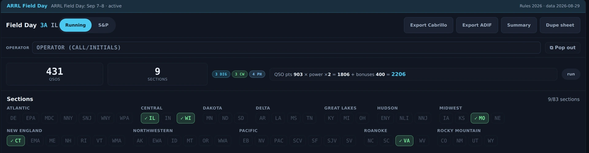
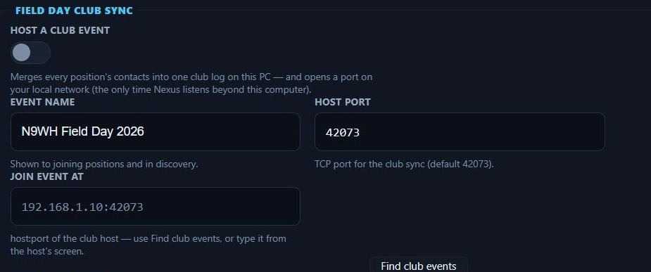
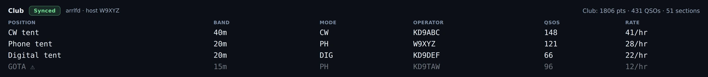
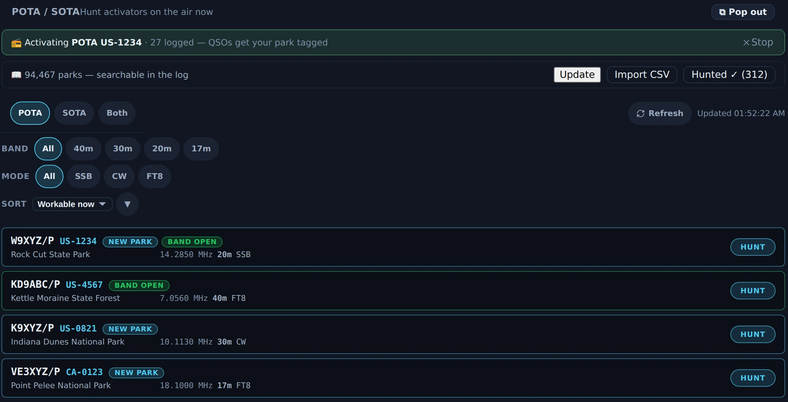

# Contesting & POTA/SOTA

Two portable/event workflows live here: **Field Day** (ARRL or Winter Field Day),
which reshapes the app for the weekend and pushes to the club's master log in
real time, and the **POTA/SOTA hunter**, which finds activators and tags your
contact for upload. The hunter ships enabled — the wizard turns everything on.
**Contest mode is the exception**: it stays off until you switch it on at the
top of the **Contest** screen (the tent in the left bar) or in
[Contesting ▸ Contest](settings-reference.md#contest), under the picker, because it
reshapes the app for a weekend most operators are not having. It is one switch for
whichever contest is picked in [Settings ▸ Contesting ▸ Contest](settings-reference.md#contest),
Field Day or any other, and it names that contest wherever it is shown: with the
mode on, the badge with the blue dot at the foot of the left rail reads its short
name (**ILQP**, **NYQP**, **WFD**, **CQ WW CW**, **JAN VHF**, and **FIELD DAY** for
ARRL Field Day).

---

## Field Day

**Contest mode** turns the event on and the app reshapes for it: the exchange
grammar, a live countdown that knows the real date rules, per-(call, band,
mode-class) dupe checking, and a scoreboard.

<!-- TODO: capture screenshot — Contest mode on Field Day — exchange entry, countdown, live scoreboard -->

### Set it up first

*Field Day Setup in Settings ▸ Contesting, Nexus 1.10.3, with Field Day mode
off. The class, section and multiplier shown are one station's own entries —
set yours from the rules for the event you are in.*

In [Settings ▸ Contesting ▸ Field Day](settings-reference.md#field-day), shown while one of
the two Field Days is picked:

1. **Contest** — ARRL Field Day or Winter Field Day, picked in
   [Settings ▸ Contesting ▸ Contest](settings-reference.md#contest) at the top of the tab.
   This changes scoring labels and export headers.
2. **Class / Category** and **ARRL Section** — these start **empty on purpose**,
   and Field Day refuses to start until you set yours. (An old default of "WI"
   sent the wrong exchange for everyone outside Wisconsin — now it's a one-time
   deliberate step.) ARRL FD wants a class like `1D`; WFD wants its class number
   and category letter, like `2O` (two transmitters, outdoor).
3. **Power multiplier**, ARRL Field Day only — ×5 (QRP/battery ≤ 5 W), ×2 (≤ 100 W),
   or ×1 (> 100 W). It multiplies your QSO points; the engine clamps it to the legal
   values. Winter Field Day scores by its objectives instead.

### Operate the event

Field Day is **all-mode**: once you initiate a contact, the digital sequencer
runs the FD exchange autonomously, and the [CW](cw.md) and [Phone](phone.md)
cockpits' log strips become FD entries with class/section and **shared dupe
checking** — one laptop covers the whole operation.

*A Field Day **test event** in Nexus 1.10.3 — a fixture, not a submitted entry. The banner
names the event and the rules year it is scoring against; the counters and the arithmetic line
show the whole sum (**QSO pts 903 × power ×2 = 1806 + bonuses 400 = 2206**), and the sections
board marks what has been worked out of the 83 sections this 1.10.3 build carried (the board
lists all 85 ARRL/RAC sections from 1.12.0 on). The per-contact exchange — class and section — is
typed in the cockpit log strips and lists under this panel.*

**The score at a glance**, in every contest. While a contest runs, the CW, Phone, RTTY and PSK
cockpits show it in the title bar of their Log pane: `ILQP · 212 pts · 48 Q · 19 mults · 41/hr`, that
is the score, the contacts, the multipliers (the worked sections at Field Day) and your rate over
your last ten contacts, the same numbers the Contest screen shows, and the rate falls while you log
nothing. The Satellites log strip and the contest logger window carry it in the strip's top line
instead, in whatever room that line has left: it is cut short rather than move anything, and
hovering it shows the whole reading.

**Super Check Partial and call history**, in every contest. As you type a call in a log
strip, a line under the boxes lists the calls active in recent contests that contain what
you have typed; click one to use it. The list is `MASTER.SCP` from supercheckpartial.com
(maintained by W9KKN): Nexus downloads it the first time a contest starts and checks for a
newer one at most once a day, and it is never shipped with Nexus. If you imported a
call-history file for this contest, the boxes it can check (a county, state, section or zone
the contest accepts) fill from it as you type, marked **history**, and whatever you type
wins. Unassisted mode turns both off. Both are set up in
[Settings › Contesting](settings-reference.md#super-check-partial-and-call-history).

The log strip in the [Satellites](satellites.md) section switches too, and it is
the one strip that does **not** take the band off your dial. It files each
contact on the band of the transponder you were holding, so you can work the
pass, turn the rotator by hand, and write the contact up once your hands are
free — the band, the frequency and the satellite tag all come from the bird, not
from whatever the radio moved to afterwards.

Everywhere else, **log as you work**: the FD log stamps each contact with the
band the radio is on at the moment you type it, so a contact entered after you
have QSY'd away files on the wrong band, both in the Cabrillo and on the
N1MM / N3FJP wire.

Logged the wrong contact? **Press Ctrl+D twice**, or click **Remove last** beside Clear
twice: the first press names your newest contest contact on the strip, the second removes
it. It is kept under **Removed** on the contest screen, out of the score and every export,
and **Restore** puts it back exactly. The [Field Day manual](../manual/Field-Day.md#take-back-the-last-contact)
has the details, including where a contact may already have gone.

Logged it with a busted call or exchange, or on the wrong band? **Press Ctrl+Y** to fix your
newest contact in place, or click **Edit** on any row of the contest screen's log. It keeps its
time and serial, and the score, dupes and exports follow the edit. Not at a club yet: there, take
it back and log it again. [Edit a Contact](../manual/Field-Day.md#edit-a-contact) has the details.

The spots are marked for the contest too. In the CW and Phone cockpits, the Band activity strip,
the pop-out band map and the Spots list strike through and dim a station you already worked on that
band and mode (the same dupe check as the log strip's DUPE badge), and put a **MULT** tag on a
station that would be a new multiplier; its tooltip names it, for example "new mult: county COOK".
A country or a WPX prefix is read from the call. A county, section or zone comes from the exchange,
so it is known only for a station you worked before, from what it sent you then. If you imported a
call-history file for the contest, a station you have never worked also gets an outlined **MULT?**
when the county, state, section or zone the file gives it would be new ("predicted from call history:
county LAKE"); a county-line station is marked for every county that would count.

The scoreboard shows its work: QSO points (phone 1, CW/digital 2) × the legal
power multiplier + a 16-item ARRL bonus checklist = total. **Winter Field Day
scores by its objectives instead**: QSO points × (the objective multipliers + 1),
from the sponsor's thirteen 2027 objectives, which you tick on the contest screen
in place of the bonuses (the [Field Day manual](../manual/Field-Day.md#winter-field-day-scoring)
lists them). While Winter Field Day runs, Nexus posts no spot over the internet,
as its rules ask.

Opening **Bonuses** does not cost you the sections board. The board is the only
part of the Field Day column that can give height, so it used to give it for
everything else and collapse to a blank strip when the fifteen-row checklist
opened. It carries a floor now and the column scrolls past that floor, so the
board a club watches all weekend stays a board. The checklist keeps its own cap
and scrolls inside itself: all fifteen rows are there, in a list of their own,
rather than 290 px of checkboxes between you and the log.

### FT8 and FT4 in each contest

On FT8 and FT4, **Running** on the Contest screen calls CQ and works whoever
answers. **S&P** listens and never calls a station by itself, with TX on or off:
you start each contact with a double-click on a CQ, or a reply to one from a
logging program, as in WSJT-X. Your answer goes out in the period opposite
the CQ's, and the contact then runs itself to RR73 and the log. After it, S&P
listens again until you pick the next CQ. On the FT cockpit, **Call CQ** is the
contest's Running and **S&P** the contest's S&P; with **Disable TX after sending
73** on, TX goes off after each S&P contact. What they
send depends on the contest, and is what WSJT-X sends in it (here K1ABC in FN42
works W9XYZ in EN37). The last column is the special operation the WSJT-X UDP
Status message reports, as WSJT-X reports it in that contest:

| Contest | Running sends | S&P sends | The contest log keeps | UDP special operation |
|---|---|---|---|---|
| ARRL Field Day | `CQ FD K1ABC FN42`, `W9XYZ K1ABC R 2B EMA`, `W9XYZ K1ABC 73` | `W9XYZ K1ABC 2B EMA`, `W9XYZ K1ABC RR73` | class and section | 3, Field Day |
| ARRL January, June and September VHF (WSJT-X's NA VHF Contest mode) | `CQ TEST K1ABC FN42`, `W9XYZ K1ABC R FN42`, `W9XYZ K1ABC 73` | `W9XYZ K1ABC FN42`, `W9XYZ K1ABC RR73` | the grid each way | 1, NA VHF |
| Sweepstakes, CQ WW, CQ WPX, and the California, Ohio, Tennessee and Texas QSO parties (no WSJT-X contest mode) | `CQ K1ABC FN42`, `W9XYZ K1ABC -12`, `W9XYZ K1ABC RR73` | `W9XYZ K1ABC FN42`, `W9XYZ K1ABC R-12`, `W9XYZ K1ABC 73` | the call only | 0, none |

Outside Field Day, Running and S&P need your grid in Settings before they
transmit. Winter Field Day and the Illinois and New York QSO parties ban FT8 and
FT4, and FT1 has no WSJT-X contest messages: in those the two buttons send Field
Day's messages, as they always have, and Field Day's runner closes without the
73. There too S&P calls nobody by itself. In ARRL Field Day and Winter Field
Day on FT8, FT4, FT2, FT1 and DX1, a double-click on a CQ while you are in the
contest's S&P, or a reply to one from a logging program, answers it in the
contest with your class and section. On FST4, Q65, MSK144 and JT65, in the
Illinois and New York QSO parties, and in other contests on FT2, FT1 and DX1, a
double-click works the station as a normal QSO outside the contest, as before.
Outside the contest's S&P, the FT cockpit's Call CQ and double-click work
outside the contest, as before, and the UDP special operation is 0.

### An operator and a logger on one radio

Many clubs put two people on one station: the operator on the radio, and a logger on a second
keyboard and mouse at a second monitor (MouseMux gives each of them their own). Click
**⧉ Logger window** on the Contest screen, or in the torn-off scoreboard beside the operator box,
and drag the window to the logger's monitor. It opens on that monitor again next time.

- **The log line comes first, in large type.** The call and exchange boxes are across the top of
  the window, with the dupe warning right under them, and the **Operator** box is on the log line's
  title line, beside Sending and I moved: Ctrl+O puts the cursor there, and Enter saves it. Under
  that are the last five contacts, newest first, and the whole Contest screen (club board, score,
  sections, log) is below, scrolling on its own.
- **A− and A+** at the top right make the log line and the last contacts smaller or larger, from
  80 to 160 %, on top of your Text size setting. That computer remembers the size for the logger
  window; until you size it there, it opens at the size of the Contest screen's own log line.
- **The same log line tops the Contest screen** in the main window while a contest runs, with its
  own A− and A+ and the Operator box on its title line, so the operator can type contacts there
  too; the rest of the screen below it uses the whole width of the window. Nothing on it transmits
  either, but in the main window Esc stops TX, as the top bar's Stop TX does, and leaves the boxes
  as they are.

- **One contact, two windows.** The logger's line and your own contest log strip (a cockpit's LOG
  pane, or the log line at the top of the Contest screen) are the same contact: whatever either of you types shows in both as it is typed, with the same dupe warning,
  Super Check Partial line, call-history fill and Ctrl+D take-back line. Enter in either window
  logs it, once: if you both press it at the same moment, the second window is told it was
  already logged.
- **Nothing in the logger window transmits.** It has no PTT, no F-key messages and no Tune, and
  the F-keys and Space do nothing there but type. Its Esc clears the log line and never touches
  your over. Stop TX and every transmit control stay on your screen; the contest switch,
  Running / S&P and scoring are read-only in the logger window.
- It logs as this computer's own position, under the mode you are operating (phone, CW, RTTY or
  digital), so club sync, N3FJP and your exports see one station. A Remote viewer sees only the
  main window.
- **A satellite pass's contacts go on the Satellites screen.** The logger window logs every contact
  on the band the radio is on, with no satellite, so at ARRL Field Day a pass contact logged there
  would count as an ordinary 2 m or 70 cm contact. While a satellite's transponder is picked on the
  Satellites screen, one line under the logger window's title names the bird and says to log its
  pass contacts there: that screen's log strip takes the band and the satellite from the pass.
  Nothing is blocked, and a contact logged in the logger window is logged as before.

### Statistics per operator

When more than one operator logs, each contact carries the call in the **Operator** box at the
moment it was logged, and the Contest screen's score area gains an **Operators** section under the
multiplier boards: one row per operator, best first.

- **QSOs, Points and New mults**, each with that operator's share of the whole. Points are QSO
  points before multipliers, power and bonuses. A multiplier counts for the operator who worked it
  first. Dupes, contacts in a mode the contest does not allow and contacts you removed count for
  nobody, exactly as they count nothing in the score.
- **Last 10 min /h and Last 60 min /h**: each operator's rate, in contacts per hour.
- **Best hour**: the UTC clock hour in which that operator logged the most contacts, and how many.
- **A band × mode table** for each operator.

Contacts logged with no operator named are a row of their own, shown as **—**. They are never
counted under the station's call. With a single operator the section is not drawn, since its one
row would repeat the score above it. The **Summary** export carries the same section, without the
rates, which describe a moment rather than the contest.

The **Operators** box, picked in any box's picker on Conditions, in the dashboard window or in the
dashboard rail beside a cockpit, shows who is at the key now and the leaderboard: QSOs, points and
the last hour's rate. A single operator is one row there. With no contest running, it says so.

### The Contest screen on another monitor

**⧉ Pop out**, at the right end of the Contest screen's top line (the one with the Contest mode
switch), opens everything below the log line in a window of its own: the Contest mode switch,
Running / S&P, the exports and the merge, the club board, the score, the county or sections board,
the bonuses and the log. Each works there as it does on the main screen. Drag the window to another
monitor; it opens there again next time, fitted to the monitors you have then.

- **The main window keeps the log line.** While the window is open, the Contest screen in the main
  window shows the log line, with the Operator box on its title line (Ctrl+O still puts the cursor
  there), and the last contacts. Where the rest was, one line says it is in its own window, with
  **Bring it back**, which closes the window.
- **Closing the window brings it back.** Its close button, Alt+F4 or Bring it back all put the
  screen back under the log line, and so does restarting Nexus: the window does not reopen with it.
- **The window's keys.** Its F-keys do nothing, so F5 cannot reload it in the middle of a contest.
  Its Esc is not a stop: stop a transmission with Esc or Stop TX in the main window.
- Turning Contest mode on or off in the window is the same save as on the main screen, and the main
  window follows it.

### Export and club interop

Exports are submittable: **Cabrillo 3.0** with real per-QSO UTC timestamps and
per-row mode tokens, plus **ADIF** with `CONTEST_ID`.

The club story is native:

- Every FD contact pushes in real time to **N3FJP** over its official TCP API
  (default port 1100). Configure the master log's host/port and use the **Test
  N3FJP** button at the site before the event.
- Nexus also broadcasts the native **N1MM+** `<contactinfo>` UDP datagram for
  N1MM-networked dashboards.

Both are fire-and-forget on background threads, so a hung logging PC can never
stall your TX slot. During ARRL Field Day the WSJT-X UDP Status message reports
`special_op = Field Day`, as WSJT-X does, so JTAlert/GridTracker auto-activate
their FD behavior too. Winter Field Day reports none, since WSJT-X has no mode
for it.

Configure [N3FJP](settings-reference.md#n3fjp-integration-club-master-log) and
[N1MM+](settings-reference.md#n1mm-integration) in Settings ▸ Logging & Connectors.

### When the contest is over

Turn Contest mode off, on the Contest screen or in Settings › Contesting with Save, and Nexus first
asks **Contest over?** with a short checklist. Nothing on it is ticked to begin with, and nothing is
done that you have not ticked:

- **Merge N contacts into my logbook**: the Contest screen's own merge. A contact already in the
  logbook is skipped, never added twice.
- **Export the Cabrillo log to Downloads**: the same file the Contest screen's Export Cabrillo
  writes.
- **Put back what the contest changed**: each of Callsign on the air, Operator at the key, Position
  name, Entry category, Entry class, Power category and Unassisted entry that the contest changed,
  shown as it is now and as it was before. Tick the ones you want back.

At a club it also says how many of this laptop's contacts the club's log does not have yet. They
still go to the host once this laptop is back with it, with the mode on or off, as long as Nexus
stays open with club sync on. So at the end of a club contest, wait until every laptop's chip reads
**Synced** before anyone turns the mode off, and on the host export the **Club Cabrillo** before
**Contest over?**: its button is on the Contest screen only while the mode is on. On the host,
putting your own call and entry class back changes nothing in the club's files: Club Cabrillo and
Club ADIF keep the call and class the club was hosted under, even with the mode turned back on to
reach them. A contact you then log on your own call stays in that laptop's own log and is not sent:
the club's log takes a contact only on the club's call, and the club block says how many it kept out.

**Turn off** does what you ticked and then turns the mode off. **Not now** changes nothing, and the
mode stays on. The merge and the export are done before the mode goes off, because they need the
contest's session; if one of them fails, nothing after it is done, the reason is shown, and the mode
stays on. With no contacts and nothing changed, the mode goes off at once, as it always did.

"Before" is how each of those settings was the first time one of them changed for this contest, or
when you turned Contest mode on, whichever came first. A change counts for the contest picked in
Settings › Contesting from a week before it starts until it ends; with none picked, that is ARRL
Field Day's week, the contest Contest mode runs then. So the club call you typed into Settings on
the Friday is offered back as your own call on the Sunday night. Nexus keeps those values until you
have put them all back, or until the contest is over and the mode is off: turn the mode off after a
rehearsal with a row left unticked, and **Contest over?** offers it again when you turn the mode off
at the end. A press made through Remote cannot merge or export, as on the Contest screen.

### Run the whole club on Nexus (club sync)

*Field Day Club Sync in Settings ▸ Contesting, Nexus 1.10.3. Hosting is off
here — nothing is listening on the network until you turn it on.*

If every position runs Nexus, you don't need a third-party master log at all.
One PC at the site turns on **Settings ▸ Contesting ▸ Field Day Club Sync ▸
Host a club event**; every other position presses **Find club events** and
clicks the event it finds, which joins it at once and saves only the join
address (or types the host's address into **Join event at** and saves).

- **The host says where to join it.** Its Contest screen, and the club section
  of Settings, say that it is hosting, on which port, and at which of its
  network addresses, after **Positions join at**, each with the name of the
  adapter it is on (Wi-Fi, Ethernet). That address is what the other laptops
  type into **Join event at**; typed without a port, an address joins port
  42073. The same line counts the other positions connected. When the host
  cannot host, the line says why: another program using the port, a port that
  would not open, or a contest club sync does not run.
- **Every other laptop says where its join stands**, under **Join event at**
  and on the Contest screen, with Contest mode on or off: looking for the host
  at that address; joined, with the event, the host's call, this laptop's
  position and its club code; turned away, in the host's own words; cannot
  reach the host, because nothing listens there or nothing answers, with what
  to check; or the host lost, and Nexus trying again.
- **Find club events** listens for 5 seconds. The host announces itself once a
  second on every network it is on, so a laptop with Wi-Fi and a cable, or with
  the virtual adapters WSL, Hyper-V or a VPN add, is found on each of them.
  When it hears nothing it says what to check; typing the host's address always
  works where a Wi-Fi network keeps laptops apart.

From then on:

*The club board in Nexus 1.10.3, torn off into its own window. The chip beside **Club** is the
sync state, the host is named next to it, and the club totals sit on the right; each row is one
operating position, and the greyed **GOTA** row carries a ⚠ because the host has not heard from
it inside the stale line. **This is fixture state, not two instances that actually synced** —
no second Nexus was running, so the picture shows what the board looks like, not evidence that
a club sync worked.*

- Each logged contact streams to the host the moment it lands; the host merges
  everything into one club log and pushes the club totals back.
- Every position gets a **club dupe warning while typing** — if another tent
  already worked that call on this band and mode (and, at a QSO party, from
  the county you have typed), you're told before you call. It's a warning, not
  a lock; your own log's dupes still refuse.
- Every laptop's **county or sections board** shows what the whole club has
  worked, so everyone sees what the club still needs: a county, state or
  section another position logs turns green with a ✓ on the host's board and
  on every other laptop's within a second, and this laptop's own are marked ⌂
  in the colour its name has in the grid below, with a legend over the board
  and both counts ("34/102 worked · 12 on this laptop"). A laptop or host on an
  earlier release shows only its own, as before.
- A live **band board** shows where every position is (band, mode, operator,
  rate), stale-marked the moment one goes quiet; a position the host removes
  reads **Removed** after its name on every laptop's board within a heartbeat
  (5 seconds). Above it a grid puts each
  position's name in the cell of its band and mode, coloured on the host by its
  link (green Connected, amber Reconnecting, red Lost), so a band and mode
  nobody is on is an empty cell. It has its own **Club Board**
  button in the left rail under Contest, and its own window — one click, on a
  second monitor or a corner of the big one, in bigger type than the dashboard
  copy because it is watched from across the tent. **Pop out board** in the club
  header opens the same window. The rail button is there whenever Field Day is
  on, before you have switched sync on: with sync off the window names the route
  that starts it rather than showing an empty board. The web scoreboard below
  carries the same band and mode per position, so the screen facing the room
  answers "who's on 20?" too.
- The sync chip tells the truth: **Synced**, **Behind n**, or **Offline** —
  contacts logged offline are journaled and re-sent automatically on
  reconnect, Contest mode on or off. If the host PC dies, enable hosting on
  any other position; everyone re-joins and nothing is lost.
- The host exports the merged **club Cabrillo / ADIF**, deduplicated the way
  the rules score it (earliest contact wins). A contest that wants repeats
  reported, such as the New York QSO Party, keeps them in the file, scoring
  zero.
- **Ctrl+D works at a club.** Pressed twice (or **Remove last**), it takes your
  newest contact back from the club too: the host keeps it, marked taken back
  and never deleted, every position's club dupe check and the board drop it,
  and the club Cabrillo and the club's counts leave it out. **Restore** under
  **Removed** puts it back everywhere. A laptop away from the host when it
  takes one back catches the club up when the link is back; its chip counts
  the take-back until then. Each laptop takes back only contacts it logged
  itself, the host included: a contact another position logged is taken back
  on that laptop, or, if that laptop is gone for good, in the club Cabrillo
  before you send it in. Every laptop in the club must run the same Nexus
  release: an older one is turned away when it joins, and told to update.

Hosting is the one time Nexus listens beyond the local computer, and only
while the toggle is on. There is no join password — a club site LAN is
trusted; the connection can only carry log rows, never key a transmitter or
change a setting. The N3FJP/N1MM pushes above keep working alongside if you
want both.

**Any contest on the picker, with two exceptions.** The club log runs the
contest the host has picked, under that contest's own rules: its exchange (a
QSO party keeps every county, and a mobile in a new county is a new contact),
what counts as a dupe (the Illinois QSO Party counts CW and digital as one
mode), its scoring and multipliers, and its own Cabrillo file and header lines.
The two exceptions are contests whose merged log would be wrong: one with a
serial number in the exchange (Sweepstakes, CQ WPX, the California QSO Party),
because the whole entry's numbers must run in one sequence and every position
gives out its own, and CQ World-Wide, whose log must say which transmitter
made each contact. For those a station neither hosts nor joins, and the contest
screen and the Club Sync settings say why. Every position must pick the
**same contest** as the host: a position logging another one is refused when it
joins, and the club chip names both contests. The [spectator
scoreboard](#the-spectator-scoreboard) shows the club's own contest too. The
manual's Field Day page has the steps for the Illinois QSO Party.

Before any club event:

- **Windows Firewall.** On each Windows laptop, press **Allow Nexus through
  Windows Firewall** in the club section of Settings ▸ Contesting. Windows asks
  for administrator rights once, as it does for **Repair clock**, and Nexus adds
  three inbound rules for itself on **Private and Public** networks, so a site
  network Windows calls Public works too: TCP on the **Host port** (42073 unless
  you change it), UDP 42074, which the host announces itself on and **Find club
  events** listens for, and TCP on the spectator scoreboard's port (7373 unless
  you change it). They are named "Nexus club sync - …". The line beside the
  button says whether they are in place; a second press, or a changed Host
  port, replaces them, and **Remove Nexus's firewall rules** takes them out.
  With Windows Firewall off there is nothing to allow, and club sync works as
  it is. If Windows itself blocks Nexus, which is what a Cancel at its own
  question leaves (and a block wins over any allow), or blocks every incoming
  connection, the line says so and where to change it. On a laptop where you
  have no administrator rights, allow Nexus by hand under Windows Security ▸
  Firewall & network protection ▸ Allow an app through firewall, on Private and
  Public networks. When a laptop cannot reach the host, check the host's
  firewall; when its Find club events hears nothing, check its own.
- **Set every clock first.** Nexus never changes a PC's clock. Each position
  measures its clock against the host's every 5 seconds over the club link, and
  from 2 seconds off its club line says so ("This PC's clock is 3 s behind the
  host's"); past 30 seconds the line is a warning. The host's club board has a
  **Clock** column for every position, with a dash for one running an older
  Nexus. The contact times in the club log and in each Cabrillo file still come
  from each position's own clock, and when two positions log the same contact the
  club log keeps the earlier one, so put a wrong clock right in that PC's own
  date and time settings. Set every laptop from one source, a phone for example,
  before the event starts.

### The spectator scoreboard

Turn on **Spectator scoreboard** (Settings ▸ Contesting ▸ Field Day Club Sync)
and any browser on the site network can show the club's board: a TV or a
projector with nothing installed. The Settings row shows the address to open. The
board is made to be read from across a room, at 1080p and at 4K:

- the **claimed score**, made the contest's own way (QSO points times the power
  tier for ARRL Field Day, times the objectives for Winter Field Day, times the
  multipliers for a QSO party, plus the bonuses), and the **rate**: the last hour,
  the last ten minutes, and a bar for each hour;
- a **map of what the contest counts**: the sections globe for the two Field Days,
  and for the Illinois QSO Party the state's 102 counties, each lit when the club
  works it, with the host's own county outlined;
- each position's **band and mode right now**, the contacts by band and mode, the
  multipliers with their counts and caps, the bonus stations, the latest contact,
  the clock and the time left.

**Any station can show it.** The host shows its own club. A position shows the
host's board, fetched from the host it joined, so the TV can sit at any table with
a spare laptop; the host's Spectator scoreboard has to be on too, on the same port.
If the host can't be reached, the TV says so in plain words, keeps the last board
it had and comes back by itself. A station with no club says so, with what to do.
Add `?theme=light` to the address for the light board, or `?theme=auto` to follow
the TV's own setting.

---

## POTA / SOTA hunter

The hunter is for **finding activators, not running activations**. It polls the
official feeds (pota.app and SOTAwatch) every 60 s.

*The POTA / SOTA hunter in Nexus 1.10.3, showing live activators.*

### The tour

Live spots with program toggles (**POTA / SOTA / Both**), band and mode filter
chips, park names, and two ranking badges:

- **NEW PARK** — the reference has never appeared in your log (computed from your
  own ADIF, not an external tracker),
- **BAND OPEN** — PSK Reporter confirms your signal is reaching that band within
  the last 15 minutes.

### Hunt an activator

*POTA / SOTA in Nexus 1.10.3 with an activation of my own running — the green banner counts the
contacts that will be stamped with the park. Under it the hunter list: **NEW PARK** on
references never logged, **BAND OPEN** where the band is two-way now, and **HUNT** on every
row. The tags themselves land in the logbook's **PARK** column. Fixture spots and a fixture
activation: nothing was hunted, logged or uploaded to POTA.*

1. Click **HUNT** on a spot. Nexus atomically registers the park as a pending
   hunt target, QSYs to the spot's frequency and mode, and opens the right
   cockpit.
2. Work the activator. The **next QSO you log with that call** — matched by base
   call, so `/P` suffixes don't break it — is automatically tagged with
   `SIG`/`SIG_INFO` (POTA) or `SOTA_REF` in standard ADIF, ready for the POTA
   uploader.

The pending hunt tags **only the first matching QSO** and **expires after 4
hours**, so a stale park reference can't contaminate an unrelated contact next
week. To end it sooner, click **✕** on the hunt banner at the top of POTA / SOTA,
or on the 🌲 hunt tag above the log line, which also takes the park the hunt
filled in out of the log line. Activators also appear as chips on the [Needed board](needed-dx.md) when
they're heard on the air. Clicking a Phone or CW activator there sets no hunt: it
puts the call and the park in that cockpit's log line, which tags the contact
when you log it, and **Clear** on the log line clears both. An FT8, FT4 or RTTY
activator clicked there still sets a hunt, because the hunt is how its park
reaches the contact.

## Honest limits

- **The POTA/SOTA section is hunter-only** — Nexus helps you *chase* activators;
  it isn't an activation logger for running your own park/summit.
- **Winter Field Day's objectives are ticked by you** — the log-checkable ones show
  a hint from the log, and nothing is ticked for you.
- Field Day **won't start until class and section are set** — that's a guard, not
  a bug.
- **Only a double-click on a CQ, or a reply to one from JTAlert or GridTracker,
  works the station in the contest.** A double-click on a station that is calling
  you, a roster or station card click, and the Tx1 to Tx6 rows still work the
  station outside the contest with the standard FT8 messages, and the contact goes
  to your log, not the contest log.
- **Club sync does not run serial-number contests or CQ World-Wide.** A club
  running Sweepstakes, CQ WPX, the California QSO Party or CQ WW logs on each
  position.
- **A contest that is not on the list logs as one with the same exchange.** The
  Scandinavian Activity Contest (RS plus a serial number, each station once per
  band) logs as CQ WPX: pick it in Settings ▸ Contesting ▸ Contest, then switch on
  Contest mode. Before you send the log, change the Cabrillo file's `CONTEST:`
  line to `SAC-SSB` (or `SAC-CW`) and delete its `CLAIMED-SCORE:` line: the score
  Nexus shows is WPX's, and the sponsor works out its own.
- **You can't tell the Field Day log which band a contact was on** — it records
  a band per contact, but always the one the radio is on at the moment you type
  the entry; nothing lets you name a different one. Log as you work, not
  afterwards.

## Related guides

- [Operate — FT8/FT4 digital](operate-digital.md)
- [Needed — DX that's on the air now](needed-dx.md)
- [Logbook & QSL](logbook-qsl.md)
- [Settings reference — Contest](settings-reference.md#contest) and [Field Day](settings-reference.md#field-day)
